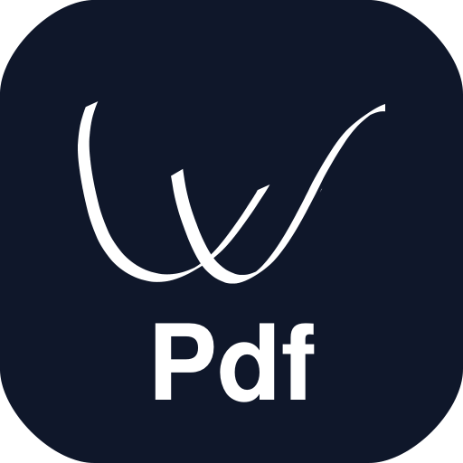
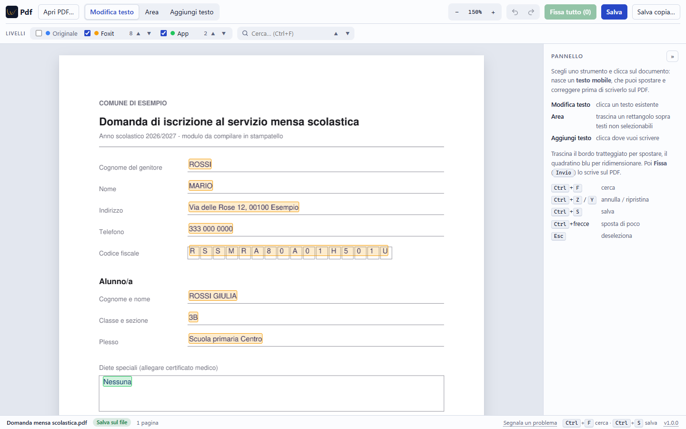

<p align="center"></p>

<h1 align="center">WPdf</h1>

<p align="center">
  <a href="https://github.com/Walt7/WPdf/releases/latest"></a>
  <a href="https://github.com/Walt7/WPdf/releases"></a>
  <a href="https://github.com/Walt7/WPdf/actions/workflows/ci.yml"></a>
  <a href="LICENSE"></a>
  
  
</p>

<p align="center"><b><a href="https://github.com/Walt7/WPdf/releases/latest/download/WPdf.exe">Scarica WPdf.exe per Windows</a></b> · <a href="#installazione-e-avvio">altre installazioni</a> · <a href="https://github.com/Walt7/WPdf/issues/new/choose">segnala un problema</a></p>

Editor PDF **gratuito e locale**: modifichi i testi di un PDF nel browser, senza caricare nulla su internet.
Pensato per moduli compilati (testi, date, codici fiscali nelle caselle) dove prima serviva un editor commerciale.

*English: free, local, browser-based PDF text editor. Everything runs on your own computer (a small Python server on `127.0.0.1`); your files are never uploaded anywhere.*

<picture>
  <source media="(prefers-color-scheme: dark)" srcset="docs/preview-dark.png">
  
</picture>

## Cosa fa
- **Tre livelli distinti**, ognuno con il suo colore:
  - **Originale** (blu): il testo del PDF. Bloccato finche' non lo attivi. Quello che modifichi resta testo della pagina: selezionabile e copiabile anche in Foxit e negli altri lettori.
  - **Foxit** (arancione): le annotazioni "Macchina da scrivere" (FreeText) create da altri programmi.
  - **App** (verde): le annotazioni create da WPdf, modificabili anche in seguito.
- **Testi mobili**: crei un testo, lo sposti e lo ridimensioni, poi lo **fissi** sul PDF.
- **Lettere in caselle** (codice fiscale, CAP...): riconosciute come un testo unico, si spostano e ridimensionano insieme.
- Frecce ▲▼ per scorrere tutti gli elementi di un livello, anche su piu' pagine.
- Salvataggio diretto sul file con copia di sicurezza, oppure "Salva copia".
- Annulla / ripristina (ultimi 40 stati).
- **Firme salvate**, come in Foxit: le crei una volta (disegnate con mouse, dito o tavoletta grafica, da foto/scansione o scritte) e le inserisci con sfondo trasparente, spostandole e ridimensionandole.

## Installazione e avvio
Serve Python 3.9 o superiore.

**Direttamente da Git (consigliato)**
```bash
pip install git+https://github.com/Walt7/WPdf
wpdf                # oppure: wpdf mio_file.pdf
```
Con `pipx` o `uv` non serve nemmeno installarlo: `pipx run --spec git+https://github.com/Walt7/WPdf wpdf` / `uvx --from git+https://github.com/Walt7/WPdf wpdf`.

**Da una copia del repository**
```bash
git clone https://github.com/Walt7/WPdf
cd WPdf
pip install -r requirements.txt
python -m wpdf      # Windows: doppio clic su "Avvia WPdf.bat" - Linux/macOS: ./run.sh
```

**Eseguibile per Windows (un solo file)**
```bash
python -m pip install pyinstaller
build.bat
```
Crea `dist\WPdf.exe` (circa 30 MB, non serve Python per usarlo). Doppio clic per avviarlo, oppure trascina un PDF sull'icona per aprirlo subito. La finestra nera resta aperta finché WPdf è in uso: chiudila per uscire.

Si apre il browser su `http://127.0.0.1:8765`. Opzioni: `--port`, `--no-browser`, `--version`. Se la porta e' occupata viene usata la successiva.

## Firme
**Firma** nella barra apre l'archivio delle firme salvate. **Nuova firma** permette di:
- **Disegnarla** con mouse, dito o **tavoletta grafica**: con la penna lo spessore segue la pressione e il lato gomma cancella. Su Windows, per la pressione con tavolette Wacom deve essere attivo *Windows Ink* nelle impostazioni del driver.
- **Caricarla** da una foto o scansione su carta bianca: lo sfondo diventa trasparente, con una regolazione della pulizia e la scelta del colore.
- **Scriverla** con un font corsivo.

Poi **Usa**, clic sul documento, sposta e ridimensiona (le proporzioni restano), **Fissa**: la firma entra nel contenuto della pagina con lo sfondo trasparente.

Le firme restano solo sul tuo computer (`%APPDATA%\WPdf\firme` su Windows, `~/.config/wpdf/firme` altrove), **cifrate**: su Windows la chiave è protetta con DPAPI e legata al tuo account, altrove è in un file leggibile solo dal tuo utente; ogni file ha un controllo di integrità. È una protezione minima: impedisce di usarle copiando la cartella, non a chi usa il tuo account già aperto. Una firma disegnata non è una firma digitale certificata.

## Aggiornamenti
All'avvio WPdf chiede a GitHub qual è l'ultima versione: parte solo questa richiesta, nessun dato dei tuoi PDF.
Se ce n'è una nuova compare un avviso con **Novità**, **Aggiorna e riavvia**, **Più tardi** e **Salta questa versione**.
- Con **WPdf.exe** l'aggiornamento è automatico: scarica il nuovo exe, ne verifica dimensione e SHA-256, lo mette al posto del vecchio e riavvia WPdf sullo stesso file. Se ci sono modifiche non salvate chiede prima di salvarle.
- Con **pip** o dal sorgente l'avviso mostra il comando da eseguire (`pip install -U git+https://github.com/Walt7/WPdf`).
- Clic sul numero di versione in basso a destra per controllare subito.
- Per disattivare il controllo: `--no-update-check` oppure la variabile d'ambiente `WPDF_NO_UPDATE_CHECK=1`.

## Uso
1. **Apri PDF…** (su Windows e Linux si apre la finestra di scelta file; su macOS inserisci il percorso).
2. **Modifica testo**: clicca un testo. **Area**: trascina un rettangolo per testi non selezionabili. **Aggiungi testo**: clicca dove scrivere.
3. Sposta il testo (trascina o Ctrl+frecce), ridimensionalo (quadratino blu), poi **Fissa** (Invio).
4. **Salva** (Ctrl+S) sovrascrive il file; la prima volta crea `nome (originale).pdf` come copia di sicurezza. **Salva copia…** scarica `nome - modificato.pdf`.

Il cestino scarta il testo mobile senza toccare il PDF; **Cancella dal PDF** rimuove davvero il testo selezionato (annullabile con Annulla finche' non salvi).

## Serve un server / VPS?
No. WPdf gira sul tuo computer. **Non metterlo su un server pubblico**: non ha login ne' sessioni separate, quindi chiunque lo raggiungesse vedrebbe e modificherebbe i tuoi PDF. Per questo ascolta solo su `127.0.0.1` e rifiuta richieste con `Host`/`Origin` diversi. Vedi [SECURITY.md](SECURITY.md).

## Limiti noti
- Il testo dell'originale che modifichi viene riscritto nella pagina con un font base (Helvetica, Times o Courier): i font originali (es. Calibri) non vengono mantenuti.
- Salvando, le annotazioni Foxit modificate perdono la formattazione interna (testo ricco), restano testo, posizione, dimensione e colore.
- Non gestisce PDF protetti da password.
- Ogni modifica salva una copia in memoria per l'annulla (massimo 40): sconsigliato con PDF molto grandi.

## Segnalare un problema
Usa il link **Segnala un problema** in basso nell'app (compila già la versione) oppure [apri una issue](https://github.com/Walt7/WPdf/issues/new/choose) scegliendo il modello. Regole in [CONTRIBUTING.md](CONTRIBUTING.md#segnalare-un-problema): una issue per problema, prova con l'ultima versione, **nessun PDF reale** né dati personali. Le vulnerabilità vanno segnalate in privato ([SECURITY.md](SECURITY.md)).

## Sviluppo
```bash
pip install -r requirements.txt
python -m unittest discover -s tests
```
Vedi [CONTRIBUTING.md](CONTRIBUTING.md) e [CHANGELOG.md](CHANGELOG.md). **Non allegare PDF reali a issue e PR**: possono contenere dati personali.

## Licenza
Il codice e' sotto licenza **AGPL-3.0-or-later** (come PyMuPDF, su cui si basa). Vedi [LICENSE](LICENSE).
Il logo (sigla WR) e' un marchio dell'autore e non e' coperto dalla licenza del codice.
